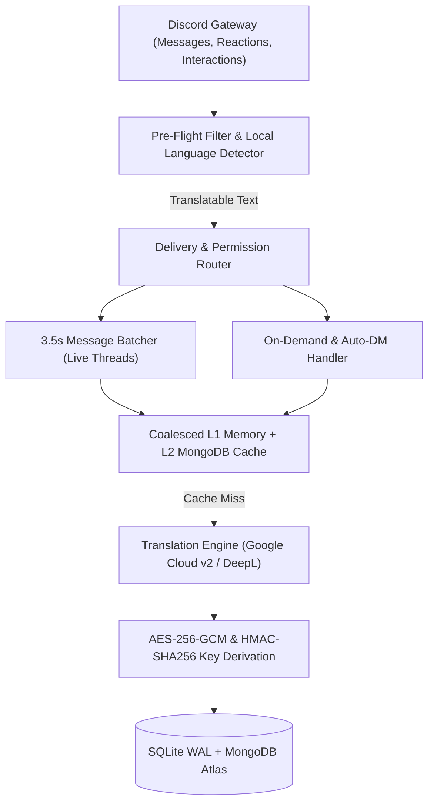

# Discord Translation Bot (`dc-translation`)

[](https://www.typescriptlang.org/)
[](https://nodejs.org/)
[](https://discord.js.org/)
[](Dockerfile)
[](LICENSE)

High-performance, quota-preserving multilingual translation bot for Discord communities, powered by **Google Cloud Translation API**, **DeepL**, and native Discord UI components.

---

## Key Capabilities

| Problem with Legacy Bots | `dc-translation` Architecture |
| :--- | :--- |
| **Public Channel Spam:** Flag reactions post permanent replies visible to everyone. | **Private Context Menu & Ephemeral Cards:** Right-click any message › **Apps › Translate** for a private card visible only to you, with live language switching. |
| **Disconnected Translation Feeds:** Users miss conversations across multiple channels. | **Unified Private Live Thread:** Streams real-time batched translations into a personal split-screen thread with per-channel focus filtering, unread catch-up, and channel muting. |
| **Unprotected Database Storage:** User settings and cached messages stored in plaintext. | **AES-256-GCM Field Encryption:** User preferences, guild guardrails, and buffered messages are encrypted at rest with per-user and per-channel HMAC-derived keys. |
| **Runaway API Quotas:** Bot commands, emojis, links, and same-language messages burn API credits. | **Pre-Flight Filtering & Coalesced Multi-Tier Cache:** Local n-gram language detection, noise/command filtering, L1 in-memory LRU cache, and L2 MongoDB Atlas TTL cache. |
| **Manual Setup Friction:** Users must memorize ISO language codes and slash commands. | **Zero-Friction Onboarding:** Auto-detects the user's Discord client locale with a 1-click setup wizard across 135+ languages. |

---

## System Architecture



### Core Engineering Highlights
- **Algorithmic Pre-Filtering ([`src/utils/text.ts`](src/utils/text.ts) & [`src/services/languageDetector.ts`](src/services/languageDetector.ts)):** Strips Discord markup, custom emojis, stickers, media URLs, ASCII emoticons, repetitive noise, and common bot commands before invoking external APIs.
- **Stampede-Proof Translation Cache ([`src/services/cache.ts`](src/services/cache.ts)):** Deduplicates concurrent in-flight requests for identical `(text, targetLanguage, engine)` tuples and persists encrypted translations in MongoDB Atlas with a 14-day TTL.
- **3.5-Second Smart Message Batching ([`src/services/messageBatcher.ts`](src/services/messageBatcher.ts)):** Coalesces rapid channel messages into clean transcript cards inside private live threads to prevent Discord rate limits.
- **Dynamic UI Localization ([`src/services/uiTranslator.ts`](src/services/uiTranslator.ts) & [`src/utils/locales.ts`](src/utils/locales.ts)):** Pre-bundled native UI dictionaries (`en`, `de`, `es`, `fr`, `it`, `ru`, `uk`) plus automatic on-demand translation and caching of bot UI interfaces for 135+ languages.

---

## User Workflows

### 1. Private Live Translation Thread (Recommended)
- Automatically creates a private Discord thread (`Translations › username`) visible only to the user.
- Docks alongside the main channel in Discord's desktop split-view.
- Includes an interactive control panel at the top of the thread to:
  - **Filter Feed Focus:** Stream `All Channels` or focus on a specific `#channel` with automatic unread catch-up and `Load More` pagination.
  - **Mute / Unmute Channels:** Silence high-traffic channels with 1 click.

### 2. Instant Context Menu Translation
- Right-click any message (or long-press on mobile) › **Apps** › **Translate**.
- Returns a private ephemeral card with:
  - Live dropdown to switch target languages on the fly.
  - **DeepL** quality enhancement button.
  - **Live Thread** launcher and **Share to Channel** action.

### 3. Country Flag Reactions
- React to any message with a country or regional flag (e.g., `🇩🇪`, `🇬🇧`, `🇫🇷`, `🇪🇸`, `🇯🇵`, `🇺🇦`, `🏴󠁧󠁢󠁥󠁮󠁧󠁿`).
- Automatically translates into the corresponding language and cleans up after the user's configured auto-delete duration (default: 3 minutes).

### 4. Interactive Onboarding & Preferences (`/setup` & `/settings`)
- Auto-detects the user's Discord client language on first interaction.
- Configure target language (with modal search across 135+ languages), delivery mode (`Live Thread`, `DM Feed`, or `On-Demand`), original quote display, auto-delete timer, and preferred engine (`Google Cloud` or `DeepL`).

---

## Commands Reference

| Command | Type | Access | Description |
| :--- | :--- | :--- | :--- |
| `/setup` | Slash Command | Everyone | Interactive 3-step onboarding wizard with automatic Discord locale detection |
| `/settings` | Slash Command | Everyone | Personal control panel for language, delivery mode, auto-delete, and engine |
| `Translate` | Message Context Menu | Everyone | Private ephemeral translation card with live language switcher |
| `Translate (Permanent)` | Message Context Menu | Configurable | Posts a public translation card in the channel (governed by `/server-settings`) |
| `/translate` | Slash Command | Everyone | Translate arbitrary text across 135+ languages with autocomplete |
| `/livethread start` | Slash Command | Configurable | Start or reopen your private real-time translation thread |
| `/livethread stop` | Slash Command | Everyone | Stop and archive your active live translation thread |
| `/livethread unmute` | Slash Command | Everyone | Unmute previously silenced channels in your live thread |
| `/setlanguage` | Slash Command | Everyone | Quickly update your default target language with autocomplete |
| `/setoriginal` | Slash Command | Everyone | Toggle original message quote visibility in translation cards |
| `/setduration` | Slash Command | Everyone | Set auto-delete timer (in minutes) for flag reaction replies |
| `/help` | Slash Command | Everyone | Display the localized interactive user guide |
| `/server-settings` | Slash Command | Manage Server | Configure server-wide anti-flood guardrails for threads, public cards, and flags |
| `/broadcast-setup` | Slash Command | Administrator | Paced DM onboarding dispatch for existing server members |

---

## Getting Started

### 1. Prerequisites
- **Node.js 20+** (or **Docker** with Docker Compose)
- **Discord Application & Bot Token** from the [Discord Developer Portal](https://discord.com/developers/applications)
- *(Recommended)* **Google Cloud Translation API Key**
- *(Optional)* **DeepL API Key** and **MongoDB Atlas URI**

### 2. Discord Bot Configuration
1. Open the [Discord Developer Portal](https://discord.com/developers/applications) and select your application.
2. Under **Bot › Privileged Gateway Intents**, enable:
   - `Message Content Intent`
   - `Server Members Intent`
3. Under **OAuth2 › URL Generator**, select scopes `bot` and `applications.commands` with permissions:
   - `View Channels`, `Send Messages`, `Send Messages in Threads`, `Create Private Threads`, `Manage Threads`, `Read Message History`, `Embed Links`, `Attach Files`, `Add Reactions`, `Manage Messages`.

### 3. Environment Configuration
Copy [`.env.example`](.env.example) to `.env` and populate your credentials:

```bash
cp .env.example .env
```

```env
# Discord Application Credentials
DISCORD_TOKEN=your_discord_bot_token
DISCORD_CLIENT_ID=your_discord_application_client_id

# Translation Engine Keys
GOOGLE_TRANSLATE_API_KEY=your_google_cloud_translate_api_key
DEEPL_AUTH_KEY=your_deepl_api_key

# AES-256-GCM Master Encryption Secret (Generate with: openssl rand -hex 32)
ENCRYPTION_SECRET_KEY=your_64_char_hex_encryption_secret

# Optional MongoDB Atlas Storage (L2 Cache & Encrypted Persistence)
MONGODB_URI=mongodb+srv://<user>:<password>@<cluster>.mongodb.net/?retryWrites=true&w=majority
MONGODB_DB_NAME=dc_translation

# Healthcheck Server Port
PORT=8080
```

### 4. Local Development & Verification
```bash
# Install dependencies
npm ci

# Register slash & context menu commands with Discord
npm run deploy

# Run typecheck and automated verification suite (security, crypto, lifecycle, locales, flags)
npm run typecheck
npm test

# Build and start production bundle
npm run build
npm start
```

### 5. Docker Deployment
```bash
docker compose up -d --build
```
The container runs as an unprivileged `node` user and exposes a healthcheck endpoint at `http://127.0.0.1:8080/health`.

---

## Security & Privacy

See [`SECURITY.md`](SECURITY.md) for full details on:
- **AES-256-GCM encryption at rest** and **HMAC-SHA256 per-user/per-channel key derivation**.
- **Header-only API key transport** (`X-Goog-Api-Key`) preventing URL query log exposure.
- **Secret isolation** across Git and Docker build contexts.

---

## License

Released under the [MIT License](LICENSE).
